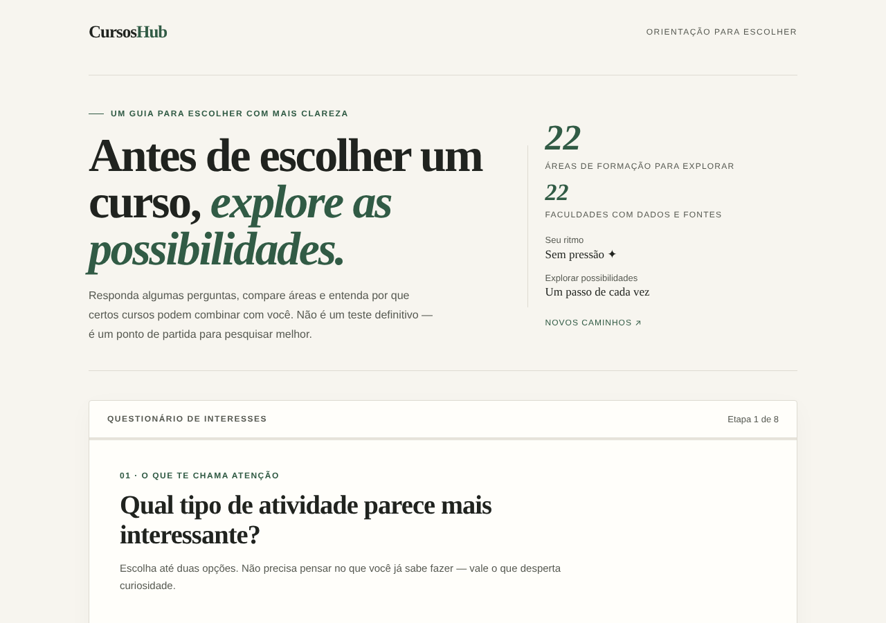
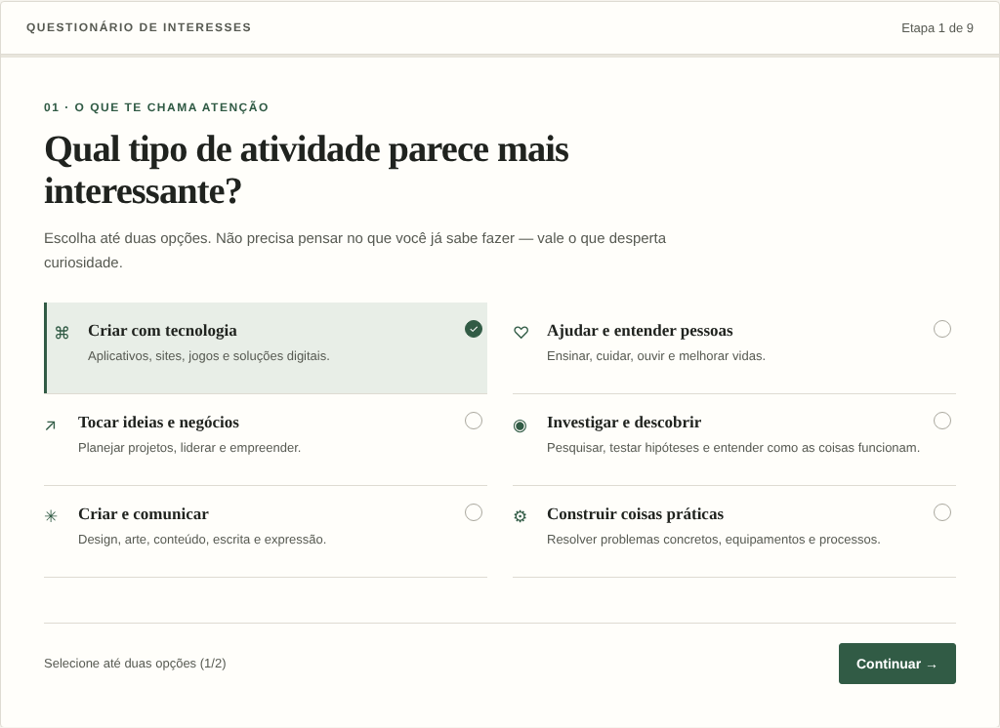
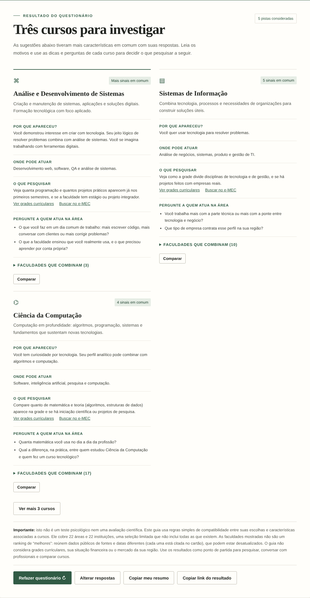

# CursosHub

Guia interativo para quem está escolhendo um curso superior. A pessoa responde algumas perguntas sobre interesses, jeito de pensar e prioridades, e o site sugere cursos para **investigar** — com os motivos da sugestão, dicas de pesquisa e perguntas para fazer a quem já atua na área.

> **Não é um teste vocacional.** O site usa regras simples de compatibilidade e diz isso claramente na tela de resultado. Ele é um ponto de partida para pesquisar, não uma avaliação científica.



## O que o projeto faz

- Questionário em 8 etapas (9 com a pergunta que se adapta aos interesses, "Vamos afunilar"). As três últimas são sobre a faculdade: pública ou privada, metodologia e estado.
- 22 áreas de formação, com explicação de **por que** cada curso apareceu.
- Resultado com 3 cursos e a opção de ver mais até 9.
- **Faculdades que combinam** em cada curso: 22 instituições (públicas: USP, Unicamp, Unesp, UFRJ, UFMG, UFRGS, UFSC, UnB, UFPR, UFPE, UFC e UFBA; privadas: Insper, Inteli, FGV, Mackenzie, PUCRS, PUC-SP, PUC-Rio, ESPM, Mauá e Einstein), com pontos fortes, pontos de atenção, nota do MEC quando existe, método de ensino e **alerta de bolsas nas privadas**. Cada cartão cita as fontes e a data.
- Comparação lado a lado de até 3 cursos.
- Dicas de pesquisa personalizadas, links para buscar grades curriculares e o e-MEC, e perguntas para um profissional da área.
- Link compartilhável do resultado e botão para copiar um resumo.
- Progresso salvo no navegador (`localStorage`).

| Pergunta | Resultado |
| --- | --- |
|  |  |

## Faculdades: o que é verificado e o que não é

Os dados ficam em `institutions.js`. As regras:

- Só entra o que apareceu em uma fonte consultada, com link e data. O que não foi encontrado fica como "não localizada" ou "não confirmado".
- A nota do MEC usada é o **IGC 2022** (faixa 1 a 5). Insper, Inteli, Mackenzie, ESPM, Mauá, Einstein e UFC não apareceram nas listas consultadas, então o site diz isso em vez de estimar. USP não participa do Enade e não tem IGC.
- As preferências (pública/privada, método, estado) **só mudam a ordem** das faculdades; nenhuma é escondida. Elas não alteram quais cursos são sugeridos.
- Não há ranking de "melhores": cada instituição mostra seus dados e o leitor compara.
- Edital, mensalidade e bolsas mudam todo semestre. Por isso cada cartão manda confirmar no site da instituição e no e-MEC.
- Dois pontos em aberto, sinalizados na tela: a bolsa parcial do Insper (fontes divergem sobre ser restituível) e dados de bolsa da PUCRS (fonte de 2021).

A UFBA entra com lista de cursos muito parcial (só Medicina e Administração apareceram nas fontes), e isso é avisado no cartão. Ficaram de fora UFPA, FEI e FAAP e há poucas opções do Norte, por falta de fonte acessível. Se você tiver uma fonte oficial, é só adicionar.

Para adicionar uma instituição, copie um objeto de `INSTITUTIONS` e preencha `courses` (nomes iguais aos de `data.js`), `quality`, `scholarships` e `sources`. Pesquise em fontes oficiais e preencha só o que encontrar.

## Como as faculdades são ordenadas

Dentro de cada curso, cada faculdade ganha pontos e a lista é ordenada por eles:

| Critério | Pontos |
| --- | --- |
| Tipo (pública/privada) igual ao que a pessoa prefere | +3 (−4 se for o oposto, mas continua listada) |
| Método de ensino preferido, **confirmado em fonte** | +4 |
| Método de ensino preferido, só indicativo | +1 |
| Fica no estado da pessoa | +2 |
| Nota máxima (IGC 5) do MEC | +3 |

Empates são resolvidos pelo IGC contínuo e depois pela ordem alfabética.

## Como funciona a pontuação

Cada resposta vira um "sinal" (por exemplo `tech`, `logic`, `team`). Cada curso tem uma lista de sinais que combinam com ele em `data.js`.

1. Cada pergunta tem um peso (`weights`): interesse principal 4, funil 3, jeito de pensar 3, ambiente 2, prioridades 2, aprendizado 1.
2. Um mesmo sinal escolhido em mais de uma pergunta conta **uma vez**, com o maior peso.
3. Os cursos são ordenados por pontuação. Em caso de empate, vence o curso mais específico para o perfil (maior fração de sinais atendidos), depois quem tem mais sinais em comum, e só então a ordem alfabética.

## Como rodar

Não precisa instalar nada. Abra o `index.html` no navegador.

Se preferir um servidor local:

```bash
python3 -m http.server 8000
# abra http://localhost:8000
```

## Estrutura

```
index.html   estrutura da página
style.css    estilos
data.js      perguntas, pesos e cursos (edite aqui para adicionar cursos)
institutions.js  faculdades, bolsas, notas do MEC e fontes
streamlit_app.py  versão para o Streamlit (embute o site)
requirements.txt  dependência do Streamlit
script.js    lógica do questionário, pontuação e resultados
favicon.svg  ícone do site
og-image.png imagem de pré-visualização para redes sociais
```

Os dados ficam em um arquivo `.js` (e não em `.json`) para o site funcionar também ao abrir o `index.html` direto do computador, sem servidor.

## Como adicionar um curso

Em `data.js`, copie um objeto da lista `courses` e ajuste `name`, `desc`, `tags`, `areas`, `why`, `research` e `ask`. Os valores válidos de `tags` estão listados no topo do arquivo.

## Acessibilidade

- Perguntas usam `input` nativos (`radio` e `checkbox`) dentro de `fieldset`, com navegação por teclado.
- Foco visível, link "Pular para o questionário" e foco movido para o título a cada etapa e para o resultado.
- Região `aria-live` para avisos (limite de duas opções, etapa atual, links copiados).
- Contraste de texto revisado e fontes a partir de 12px.
- Ícones decorativos escondidos de leitores de tela; respeita `prefers-reduced-motion`.

## Limitações

- Cobre 22 áreas e 22 instituições, não todas as existentes. Algumas listas de cursos vêm de fontes antigas (UFMG e UnB, de 2018; Unesp, de 2021; UFRJ, de 2022).
- Não considera grades curriculares, sua situação financeira nem o mercado de trabalho da sua região.
- As afinidades entre respostas e cursos foram definidas manualmente e são simplificadas.

## Publicar de graça

**GitHub Pages:** suba os arquivos para um repositório, vá em *Settings → Pages* e escolha a branch `main` na pasta raiz.
**Netlify ou Vercel:** arraste a pasta do projeto ou conecte o repositório; não há etapa de build.

Depois de publicar, troque `og-image.png` em `index.html` pela URL completa da imagem (por exemplo `https://seu-usuario.github.io/cursoshub/og-image.png`) para a pré-visualização funcionar nas redes sociais.

## Publicar no Streamlit

O Streamlit roda Python, e este site é HTML/CSS/JS. Por isso o `streamlit_app.py` lê os arquivos, junta tudo em uma página só e a exibe dentro do app com `st.iframe` (em versões antigas, `st.components.v1.html`). Nada do site precisa ser reescrito.

```bash
pip install -r requirements.txt
streamlit run streamlit_app.py     # teste local, normalmente em http://localhost:8501
```

Para publicar de graça no Streamlit Community Cloud:

1. Suba a pasta inteira para um repositório no GitHub (os arquivos `.html`, `.css` e `.js` têm de ficar na mesma pasta do `streamlit_app.py`).
2. Entre em [share.streamlit.io](https://share.streamlit.io), clique em *Create app* e escolha o repositório, a branch `main` e o arquivo principal `streamlit_app.py`.
3. Clique em *Deploy*. O endereço sai no formato `https://seu-app.streamlit.app`.

Diferenças em relação ao site comum:

- O site fica dentro de um quadro de altura fixa (1500 px, ajustável no fim do `streamlit_app.py`) e rola dentro dele.
- O botão **Copiar link do resultado** some, porque o quadro não tem endereço próprio. O botão de resumo continua funcionando.
- As meta tags de compartilhamento (`og:image`) não valem no Streamlit, porque o Streamlit controla o `<head>` da página.
- Se a ideia é só ter um link público do site, o GitHub Pages (acima) mantém tudo funcionando, inclusive o link compartilhável.

## Ideias para o futuro

- Mais cursos e pesos ajustados com a ajuda de estudantes e profissionais.
- Dados por região (instituições e mercado).
- Testes automatizados da pontuação.
